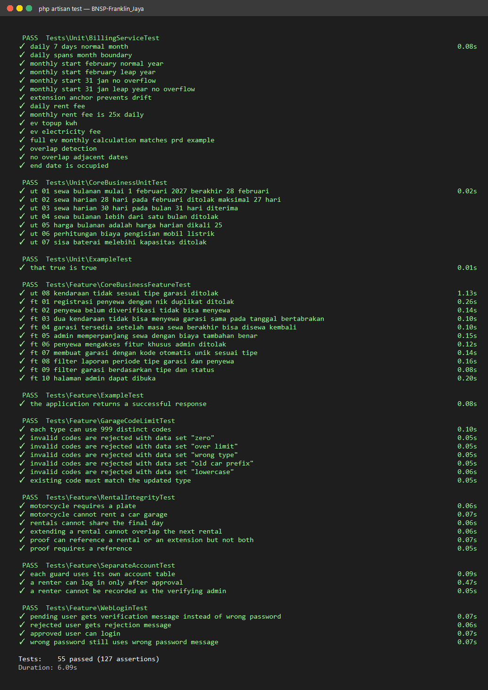

# Pengujian Sistem

## 1. Pengujian Sistem

Pengujian dijalankan dengan perintah:

```bash
php artisan test
```

Hasil akhir: **55 passed (127 assertions)**. Test plan inti (UT-01 s.d. UT-08 dan FT-01 s.d. FT-10) seluruhnya lolos.

| Test ID | Expected result | Actual result | Status |
|---|---|---|---|
| UT-01 | Sewa bulanan mulai 1 Februari 2027 berakhir 28 Februari 2027 | `monthlyEndDate(2027-02-01)` menghasilkan `2027-02-28` | Lolos |
| UT-02 | Sewa harian 28 hari pada Februari ditolak, maksimal 27 hari | `maxDailyDays(2027-02-01)` = 27; `assertDailyDuration(..., 28)` melempar `InvalidArgumentException` | Lolos |
| UT-03 | Sewa harian 30 hari pada bulan 31 hari diterima | `maxDailyDays(2027-01-01)` = 30; durasi 30 hari valid; tanggal akhir `2027-01-30` | Lolos |
| UT-04 | Sewa bulanan lebih dari satu bulan ditolak | `calculate(..., months: 2)` melempar `InvalidArgumentException` | Lolos |
| UT-05 | Harga bulanan = harga harian × 25 | `calcMonthlyRentFee(50000)` = 1.250.000 | Lolos |
| UT-06 | Biaya pengisian EV sesuai selisih kapasitas dan sisa baterai | 60 kWh, SOC 25% → isi 45 kWh; listrik 112.500; total 1.362.500 | Lolos |
| UT-07 | Sisa baterai melebihi kapasitas ditolak | `calcTopupKwh(60, 101)` melempar `InvalidArgumentException` | Lolos |
| UT-08 | Kendaraan tidak sesuai tipe garasi ditolak | Sepeda motor di garasi `mobil` ditolak: `Garasi tidak kompatibel dengan kendaraan ini.` | Lolos |
| FT-01 | Registrasi penyewa dengan NIK duplikat ditolak | Validasi `nik` gagal; jumlah user dengan NIK tersebut tetap 1 | Lolos |
| FT-02 | Penyewa belum diverifikasi tidak bisa menyewa | Akun `pending` ditolak oleh `RentalService`; tabel `rentals` tetap 0 baris | Lolos |
| FT-03 | Dua kendaraan pada garasi sama dan tanggal bertabrakan ditolak | Rental kedua ditolak: `Garasi sudah dipesan untuk rentang tanggal tersebut.`; tabel `rentals` 1 baris | Lolos |
| FT-04 | Garasi tersedia setelah masa sewa berakhir bisa disewa kembali | Rental 1–3 April selesai; rental berikutnya 4 April berhasil; total 2 rental | Lolos |
| FT-05 | Admin memperpanjang sewa dengan biaya tambahan benar | Perpanjangan bulanan: biaya 1.250.000; akhir baru `2027-03-31` | Lolos |
| FT-06 | Penyewa mengakses fitur khusus admin ditolak | Redirect ke `/login` dengan pesan `Akses ditolak.` | Lolos |
| FT-07 | Membuat garasi dengan kode otomatis unik sesuai tipe | Dihasilkan `C001`, `C002`, dan `E001` | Lolos |
| FT-08 | Filter laporan periode, tipe garasi, dan penyewa sesuai | Filter 1–28 Feb + tipe `ev` + penyewa `Siti` menampilkan 1 dari 3 rental | Lolos |
| FT-09 | Garasi dapat difilter berdasarkan tipe dan status | Filter tipe `mobil` + status aktif menampilkan 1 garasi yang sesuai | Lolos |
| FT-10 | Tombol/halaman admin dapat dibuka | Dashboard, penyewa, garasi, tambah garasi, transaksi, detail, perpanjangan, dan laporan semua HTTP 200 | Lolos |

### Screenshot Terminal


